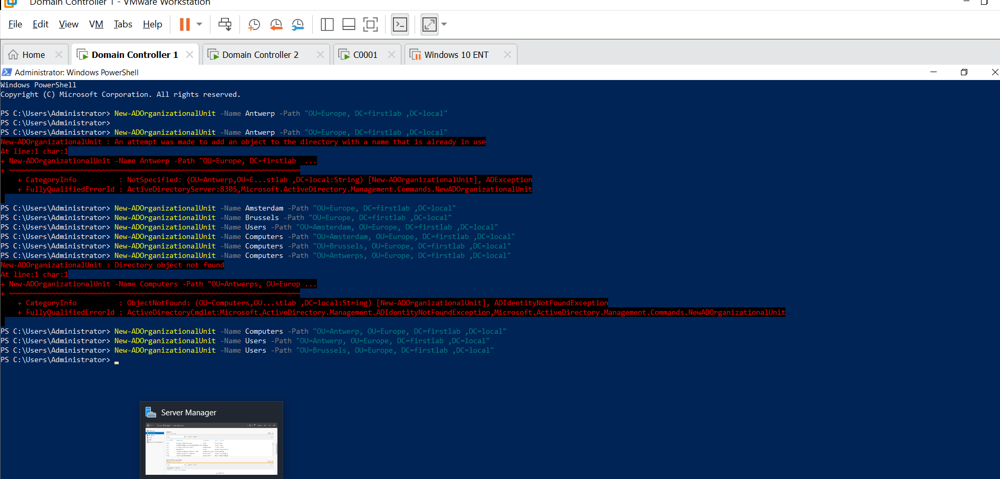
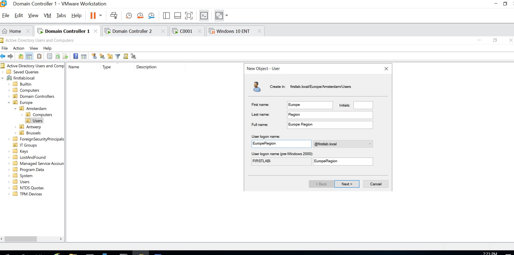

# Creating Organizational Units, Users, and Groups

## Objective
Build a hierarchical Active Directory structure, create a sample IT administrator account and security group, and delegate selected account-management tasks.

## Environment
- **Virtualization:** VMware
- **Server OS:** Windows Server
- **Directory service:** Active Directory Domain Services (AD DS)
- **Tools:** Active Directory Users and Computers, PowerShell, Delegation of Control Wizard

## Tasks Completed

### 1. Created Organizational Units using Powershell
Created a parent OU named `Europe` with child OUs for:
- Brussels
- Amsterdam
- Antwerp

Created additional `Users` and `Computers` OUs within the city structure, and created an `IT Groups` OU to organize IT-related security groups.

### 2. Created a User Account
Created a sample IT administrator user account in the Amsterdam `Users` OU.

### 3. Created a Security Group
Created the `Europe Group IT Admins` security group in the `IT Groups` OU and added the sample IT administrator account as a member.

### 4. Delegated Control
Used the Delegation of Control Wizard to delegate selected user and group management tasks:
- Create, delete, and manage user accounts
- Reset user passwords and require a password change at next logon
- Read user information
- Create, delete, and manage groups
- Modify group membership

The delegation wizard completed successfully. Delegated permissions apply within the configured scope; verify the target OU and group assignment when reviewing the lab.

## Results
Created a hierarchical OU structure, a sample user account, a security group, and a delegated administration configuration in Active Directory.

## Key Takeaways
- Organizational Units help organize directory objects and define scopes for administration.
- Security groups simplify management of access and administrative responsibilities.
- Delegation of control can grant specific management permissions without automatically making an account a Domain Admin.
- PowerShell can be used to create and verify Active Directory objects.

## Skills Demonstrated
Active Directory administration, OU design, user and group management, PowerShell, delegated administration, and least-privilege concepts.

